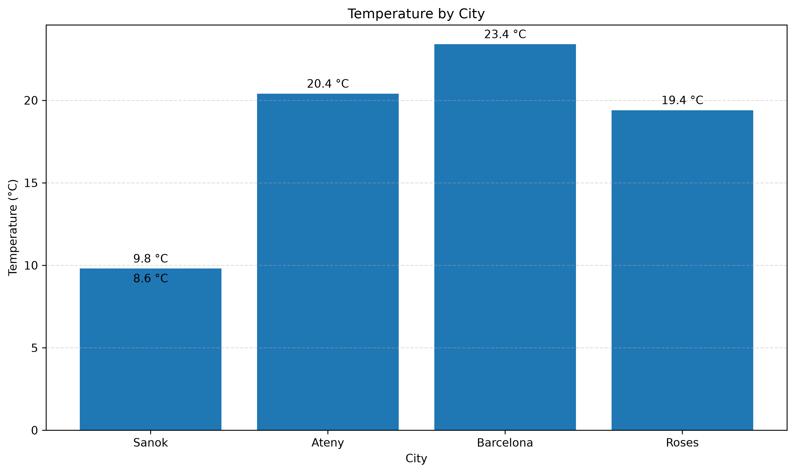
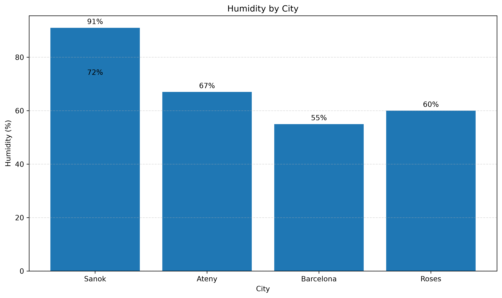
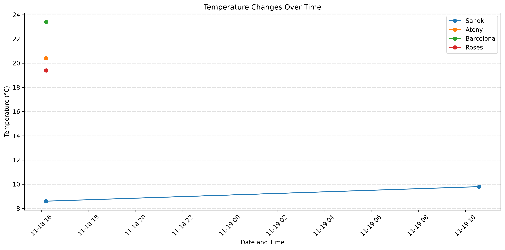

# Weather Data Analyzer

A Python application that retrieves real-time weather data from the Open-Meteo API, stores historical measurements, analyzes weather conditions, and generates data visualizations.

## Features

- **Weather Data Retrieval** – Fetches current weather information using the Open-Meteo Geocoding API and Weather API.
- **Data Storage** – Saves weather measurements to CSV files with timestamps.
- **Temperature Analysis** – Calculates average, maximum, and minimum temperatures and identifies the warmest and coldest cities.
- **Humidity Analysis** – Identifies cities with high humidity and ranks locations by humidity levels.
- **Weather Comfort Analysis** – Filters cities based on temperature and humidity conditions.
- **Data Visualization** – Generates charts using Matplotlib:
  - Temperature by city
  - Humidity by city
  - Temperature changes over time
- **Error Handling** – Handles API connection errors, missing files, invalid CSV data, and other potential issues.
- **Unit Testing** – Includes automated tests using Python's unittest framework.

## Technologies

- Python
- Pandas
- Matplotlib
- Requests
- Open-Meteo API
- CSV
- Unittest
- Git

## Project Structure

```text
weather-data-analyzer/
│
├── data/
│   ├── humidity_chart.png
│   ├── temperature_chart.png
│   └── temperature_history_chart.png
│
├── tests/
│   ├── test_analysis.py
│   ├── test_main.py
│   ├── test_visualization.py
│   ├── test_weather_api.py
│   └── test_weather_storage.py
│
├── analysis.py
├── main.py
├── visualization.py
├── requirements.txt
├── README.md
└── .gitignore
```

## Installation

1. Clone the repository:

```bash
git clone YOUR_GITHUB_REPOSITORY_URL
```

2. Navigate to the project directory:

```bash
cd weather-data-analyzer
```

3. Install dependencies:

```bash
pip install -r requirements.txt
```

## Usage

Run the application:

```bash
python main.py
```

Enter a city name when prompted.

The application retrieves current weather information, displays the results, and saves measurements to a CSV file.

Weather analysis and visualizations can then be generated from the collected data.

## Running Tests

Run the automated test suite:

```bash
python -m unittest discover -s tests -v
```

## Visualizations

### Temperature by City



### Humidity by City



### Temperature Changes Over Time



The project currently includes 20 automated tests covering data analysis, API functionality, CSV storage, visualization, and application execution.

## Data Source

Weather data is provided by [Open-Meteo](https://open-meteo.com/).

## Author

Created as a personal Python programming and data analysis project.